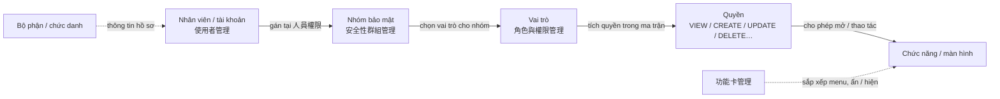
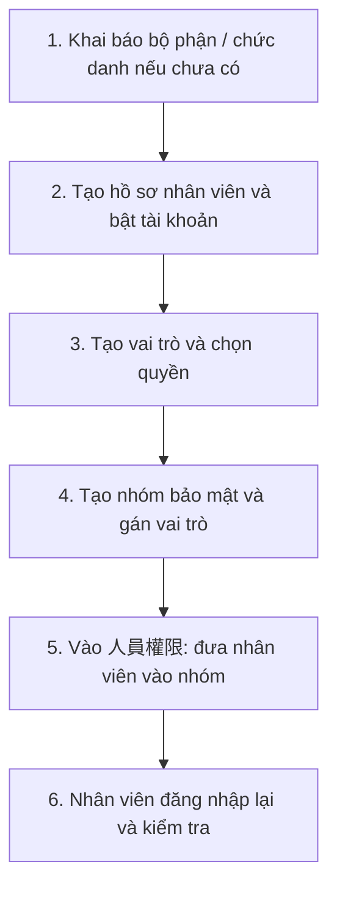

# Winform4System

Ứng dụng WinForms .NET Framework 4.8, giao diện DevExpress bằng tiếng Trung phồn thể, truy cập PostgreSQL qua EF6 và lưu tệp qua Share Data API.

## Nhân viên, nhóm và quyền: dùng mục nào?

**Vai trò quy định được làm gì. Nhóm bảo mật gom những người cần cùng bộ vai trò. Nhân viên nhận quyền thông qua nhóm mình tham gia.**

| Mục trên giao diện | Dùng để làm gì? | Ví dụ |
| --- | --- | --- |
| 使用者管理 | Tạo/sửa hồ sơ nhân viên và bật/tắt tài khoản ứng dụng. | Mã nhân viên, tên Trung/Việt, bộ phận, chức danh. |
| 部門管理 | Khai báo cơ cấu bộ phận. | 軋鋼部 — bộ phận cán thép. |
| 職稱管理 | Khai báo chức danh trong hồ sơ. | 倉管員 — nhân viên kho. |
| 角色與權限管理 | Tạo vai trò và chọn các quyền cho vai trò đó. | Vai trò chỉ xem kho, vai trò vận hành kho. |
| 安全性群組管理 | Tạo nhóm bảo mật và gán vai trò cho nhóm. | Nhóm những người chỉ được xem kho. |
| 人員權限 | Chọn nhân viên và gán họ vào các nhóm bảo mật. | Đưa một nhân viên vào nhóm chỉ xem kho. |
| 功能卡管理 | Cấu hình card, nhóm menu, màn hình, thứ tự, icon, ẩn/hiện. | Nhóm menu 機邊庫【經理室】. |

**Ba loại “nhóm” cần phân biệt:** bộ phận là thông tin tổ chức; nhóm trong 功能卡管理 là cách sắp xếp menu; 安全性群組 mới là nhóm dùng để cấp quyền. Đặt chức danh “quản lý” hoặc chuyển menu vào 經理室 không tự cho nhân viên quyền quản lý. Nhóm bảo mật ở đây là nhóm trong ứng dụng, không tự đồng bộ nhóm domain/AD.

## Sơ đồ cấp quyền



Nếu trình đọc không hiển thị Mermaid, luồng tương ứng là:

```text
Nhân viên → tham gia Nhóm bảo mật → nhận các Vai trò → nhận các Quyền

Một nhân viên có thể vào nhiều nhóm.
Một nhóm có thể có nhiều vai trò và nhiều nhân viên.
Một vai trò có thể dùng cho nhiều nhóm và chứa nhiều quyền.
Quyền cuối cùng = hợp tất cả quyền nhận được qua các nhóm/vai trò đang có hiệu lực.
```

Ví dụ: một người thuộc cả nhóm chỉ xem kho và nhóm quản lý kho thì vẫn có quyền quản lý. Bỏ tích một quyền trong vai trò chỉ xem không phủ định quyền mà vai trò khác đã cấp. Hiện chưa có cơ chế “cấm” riêng để ghi đè các quyền đã được cấp từ nơi khác.

## Tạo và gán từ đầu theo thứ tự nào?



Các bước sau dùng **ví dụ minh họa**, không tự tạo tài khoản hoặc nhóm trong database. Nếu đã có vai trò/nhóm phù hợp thì dùng lại, không cần tạo mới cho từng người.

### 1. Khai báo bộ phận và chức danh

Vào **部門管理** và **職稱管理** để thêm danh mục còn thiếu. Bộ phận dùng cho hồ sơ và có thể được nghiệp vụ dùng để lọc dữ liệu; chọn bộ phận không thay cho việc cấp quyền.

### 2. Tạo nhân viên tại 使用者管理

Thêm hồ sơ với mã nhân viên đúng dạng `VNW` + 7 chữ số, ví dụ `VNW0000001`; nhập tên Việt, tên Trung nếu có, bộ phận và chức danh; bật tài khoản nếu cho phép đăng nhập.

Ứng dụng tạo hồ sơ/tài khoản nội bộ; bước này không tạo tài khoản domain mới. Nhân viên tiếp tục dùng tài khoản và mật khẩu domain công ty. Có tài khoản ứng dụng chưa đồng nghĩa đã có quyền xem chức năng.

### 3. Tạo vai trò tại 角色與權限管理

Chọn thêm mới, ví dụ mã `SPARE_PART_READONLY`, tên **機邊庫唯讀人員**. Trong tab **權限矩陣**, chọn quyền theo nhu cầu rồi lưu.

Ví dụ chỉ cho mở card 機邊庫 và xem 備品資料:

| Chức năng | Quyền cần chọn | Kết quả |
| --- | --- | --- |
| 機邊庫 (`ASSET.SPARE_PART`) | `ASSET.SPARE_PART.VIEW` | Được mở module kho gốc. |
| 備品資料 (`ASSET.SPARE_PART.MATERIAL`) | `ASSET.SPARE_PART.MATERIAL.VIEW` | Được mở màn hình dữ liệu vật tư. |

Không chọn `CREATE`, `UPDATE`, `DELETE`, `APPROVE` hoặc `ADMIN` nếu vai trò này chỉ được xem. Chỉ tích các ô quyền mà màn hình hỗ trợ; ô không có permission tương ứng không thể chỉnh.

**Quyền mở menu và quyền làm nghiệp vụ là hai lớp:** mở được 備品資料 không tự cho phép thêm/sửa/xóa vật tư. Với kho hiện tại, các quyền thao tác dùng mã chung như `ASSET.SPARE_PART.CREATE`, `.UPDATE`, `.DELETE`, `.EXPORT`; không phải mỗi mục con đều có đầy đủ quyền thao tác riêng.

Các màn hình trong 經理室 như kiểm kê, chi phí và thu hồi còn yêu cầu quyền nghiệp vụ gốc `ASSET.SPARE_PART.APPROVE`, ngoài quyền `.VIEW` của mục menu và quyền xem module kho. Di chuyển nhóm/menu không bỏ các điều kiện này.

**Lưu ý với ADMIN:** riêng `ASSET.SPARE_PART.ADMIN` hiện cho phép toàn bộ quyền có tiền tố `ASSET.SPARE_PART.`. Không cấp quyền này khi muốn giới hạn người dùng chỉ xem một vài mục. Quy tắc này không có nghĩa mọi quyền `ADMIN` ở các module khác đều tự bao gồm tất cả quyền con.

### 4. Tạo nhóm tại 安全性群組管理

Ví dụ tạo mã `WAREHOUSE_READERS`, tên **機邊庫查閱群組**. Trong tab **指派角色**, chọn vai trò `SPARE_PART_READONLY` vừa tạo rồi lưu.

Tab **群組成員** dùng để xem thành viên của nhóm; việc đưa nhân viên vào nhóm thực hiện ở **人員權限**. Vai trò có thể dùng lại cho nhiều nhóm, không cần sao chép ma trận quyền.

### 5. Đưa nhân viên vào nhóm tại 人員權限

Tìm nhân viên → nhấp chuột phải → **設定人員權限** → tích nhóm `WAREHOUSE_READERS` → **儲存群組設定**.

Như vậy ba chỗ gán cụ thể là:

```text
角色與權限管理:     SPARE_PART_READONLY → chọn các quyền VIEW
安全性群組管理:     WAREHOUSE_READERS   → chọn vai trò SPARE_PART_READONLY
人員權限:          VNW0000001         → chọn nhóm WAREHOUSE_READERS

Kết quả:
VNW0000001 → WAREHOUSE_READERS → SPARE_PART_READONLY → quyền xem kho / vật tư
```

Không gán vai trò trực tiếp vào nhân viên và không tích quyền lẻ trực tiếp cho nhân viên ở màn hình này. Nhân viên nhận vai trò/quyền thông qua các nhóm đã chọn.

### 6. Đăng nhập lại và kiểm tra

Nhân viên đăng xuất rồi đăng nhập lại để nạp quyền mới. Kết quả ví dụ: mở được 機邊庫, thấy 備品資料, các thao tác thêm/sửa/xóa không được cấp sẽ ẩn hoặc bị vô hiệu hóa.

Để thử vai trò chỉ xem, dùng nhân viên không đồng thời thuộc nhóm quản trị. Tài khoản `VNW0014732` đang có quyền quản trị sẽ nhận hợp các quyền từ những nhóm khác, nên thêm nhóm chỉ xem cho tài khoản đó không làm nó mất quyền quản trị.

## Sau này thay đổi quyền ở đâu?

| Nhu cầu | Thao tác |
| --- | --- |
| Thêm một người vào nhóm làm cùng công việc | Tạo hồ sơ nếu thiếu, rồi gán nhóm tại 人員權限. |
| Cho toàn bộ nhóm được thêm một thao tác | Sửa ma trận của vai trò mà nhóm đang dùng; kiểm tra các tab 受影響群組 / 受影響人員 trước khi lưu. |
| Một nhóm cần thêm một bộ quyền có sẵn | Gán thêm vai trò tại 安全性群組管理. |
| Một người chuyển công việc | Thay nhóm tại 人員權限; kiểm tra và bỏ các nhóm cũ không còn phù hợp. |
| Thu hồi quyền của một người | Gỡ người đó khỏi mọi nhóm đang cấp quyền cần thu hồi, rồi yêu cầu đăng nhập lại. |
| Nhân viên nghỉ việc | Tắt tài khoản trong 使用者管理; phiên bị mất hiệu lực qua kiểm tra phiên của ứng dụng. |
| Chỉ đổi tên, vị trí hoặc ẩn menu | Sửa tại 功能卡管理; thao tác này không thay thế việc thu hồi permission. |

Mã nhóm và vai trò dùng chữ hoa tiếng Anh, số, dấu gạch dưới, bắt đầu bằng chữ cái; tên hiển thị dùng tiếng Trung phồn thể. Mã đã tạo không đổi; có thể sửa tên và nội dung gán.

## Đã gán mà vẫn chưa thấy chức năng?

Kiểm tra theo luồng sau:

1. Đã tạo và bật tài khoản đúng mã nhân viên chưa? Đã đăng nhập lại sau khi đổi quyền chưa?
2. Nhân viên đã thuộc nhóm cần dùng chưa? Liên kết có đang bật và chưa hết hạn không?
3. Nhóm và vai trò có đang bật, và nhóm đã được gán đúng vai trò chưa?
4. Vai trò có quyền `.VIEW` của mục menu, quyền module gốc và quyền nghiệp vụ mà màn hình cần chưa?
5. Trong 功能卡管理, mục đó và các nhóm cha có bật/hiển thị không? Nhóm không có mục con được phép xem sẽ không xuất hiện.

Ngược lại, nếu đã bỏ quyền mà người đó vẫn dùng được, kiểm tra các nhóm/vai trò khác và quyền `ASSET.SPARE_PART.ADMIN`, rồi đăng nhập lại. Hệ thống cộng quyền từ nhiều nguồn.

## Cấu trúc

- `Winform4System`: giao diện DevExpress và điểm khởi động.
- `Winform4System.Core`: model dùng chung và thông tin phiên người dùng.
- `Winform4System.Business`: xác thực, phân quyền, cấu hình chức năng và service nghiệp vụ.
- `Winform4System.DataAccess`: entity, mapping EF6 và repository PostgreSQL.
- `Winform4System.Logging`: logger file độc lập database.
- `Database`: script nền cho nhân sự, tài khoản, nhóm bảo mật, vai trò và phân quyền.

Luồng tham chiếu chính: `UI -> Business -> DataAccess`, các model chung nằm trong `Core`.

## Chạy ứng dụng

1. Mở `Winform4System.sln` bằng Visual Studio 2022.
2. Chọn `Winform4System` làm Startup Project.
3. Build cấu hình `Debug | Any CPU`.
4. Cấu hình file kết nối/API cục bộ theo [hướng dẫn PostgreSQL](Database/PostgreSQL/README.md), chọn đúng môi trường Test/Prod rồi chạy ứng dụng.

Log được tạo trong thư mục `Logs` cạnh file `.exe`.

## Database

Các file `Winform4System/connectionStrings.local.config` và `Winform4System/appSettings.local.config` được bỏ qua bởi Git; không commit mật khẩu database hoặc API key.

Muốn tự điền đăng nhập khi chạy Debug, đặt `DebugLoginUserId` và `DebugLoginPassword` trong `appSettings.local.config`. Bỏ trống nếu không dùng; bản Release không tự điền các giá trị này. Không ghi mật khẩu trực tiếp vào code.

Dùng schema/migration hiện tại trong [Database/PostgreSQL](Database/PostgreSQL/README.md). Thư mục `Database/Scripts` chứa script SQL Server cũ, không dùng để khởi tạo PostgreSQL.
